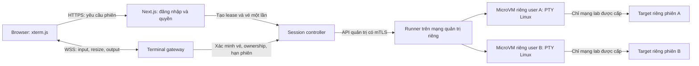

# Phương án Cyber Lab Linux thật — chờ duyệt

Ngày nghiên cứu: **08/11/2026**. Đây là phương án kỹ thuật, chưa phải tính năng đã triển khai. Chưa cài xterm.js, tạo sandbox, mua tài nguyên, thêm endpoint thực thi lệnh, đổi schema hay deploy.

## 1. Đích đến và quyết định đề xuất

Cyber Lab hiện tại là khu bài viết được bảo vệ bằng đăng nhập. Terminal thực hành tương lai phải nối tới **PTY của một hệ điều hành Linux thật**, có filesystem/process riêng cho từng người dùng. xterm.js chỉ vẽ terminal và chuyển phím; nó không cung cấp Linux hoặc ranh giới bảo mật.

Đề xuất giữ website và xác thực trên Railway; tách dịch vụ WebSocket và cụm thực thi khỏi tiến trình Next.js/MySQL. Ưu tiên **mỗi phiên một microVM**, được tạo từ image đã kiểm soát. Phương án microVM cho phép tách kernel giữa người học; Firecracker là một công nghệ phù hợp để đánh giá, cần máy chủ Linux có KVM và vận hành riêng. Chưa khẳng định một VPS bất kỳ hoặc service Railway thông thường đáp ứng KVM. [Thiết kế Firecracker](https://github.com/firecracker-microvm/firecracker/blob/main/docs/design.md).

Không chạy shell của người học bằng `child_process`/`node-pty` trong container website. Nếu dùng `node-pty`, nó phải ở trong guest của người học. Không đưa Docker socket, host mount, thư mục ứng dụng hoặc thông tin kết nối MySQL vào guest.

## 2. Kiến trúc và luồng phiên

Luồng dự kiến:

1. Next.js kiểm tra user còn hoạt động, quyền mở lab, CSRF/Origin và quota. Không lấy user ID, sandbox ID hoặc quyền từ client làm căn cứ tin cậy.
2. Controller giữ mapping `sessionId → ownerId, sandboxId, trạng thái, expiresAt, lease`; cấp tài nguyên bằng thao tác nguyên tử để hai tab không vượt quota.
3. Cấp vé dùng một lần, TTL khoảng 30 giây, ràng buộc user/session/audience. Đề xuất ký bất đối xứng: gateway chỉ giữ public key, không nhận `SESSION_SECRET` hoặc mật khẩu DB. Kho lease riêng và API xác minh nội bộ xử lý thu hồi vé/phiên.
4. Browser mở WSS; kiểm tra Origin chính xác và tiêu thụ vé trước khi nhận input. Không đưa JWT đăng nhập dài hạn vào query URL hoặc log. Sau kết nối phải xác minh lại trạng thái tài khoản/lease định kỳ và đóng khi logout, khóa tài khoản hoặc hết hạn.
5. Gateway chuyển byte tới PTY trong guest qua kênh quản trị có xác thực; hỗ trợ resize, Ctrl+C, tương tác `vim/top`, backpressure và mã kết thúc. Không ghép input thành shell command trên host/controller.
6. Khi kết thúc: đóng socket, hủy guest và target riêng, xóa disk tạm, giải phóng quota. Watchdog độc lập thu hồi phiên mồ côi khi gateway crash/redeploy; không chỉ dựa vào việc browser gửi sự kiện đóng trang.

WSS, kiểm tra Origin, phân quyền từng phiên và giới hạn payload là yêu cầu của thiết kế; WebSocket không tự cung cấp authentication. [OWASP WebSocket Security](https://cheatsheetseries.owasp.org/cheatsheets/WebSocket_Security_Cheat_Sheet.html).

## 3. Giới hạn ban đầu để duyệt

Các số dưới đây là **cấu hình đề xuất**, chưa áp dụng và cần đo trong PoC.

| Tài nguyên/chính sách | Đề xuất ban đầu | Nơi cưỡng chế |
|---|---|---|
| Phiên của một người | 1 phiên hoạt động; reconnect về phiên của chính mình | Controller và lease nguyên tử |
| Đồng thời toàn hệ thống | 5 phiên; có hàng đợi khi đầy | Scheduler; giữ phần tài nguyên cho host |
| CPU / RAM guest | Tối đa 1 vCPU / 2 GB; không overcommit RAM ở giai đoạn đầu | Hypervisor và host cgroup |
| Disk ghi | 2 GB riêng cho phiên, image gốc bất biến | Disk overlay có quota từ host |
| Process / file descriptor | Thử giới hạn 128 PID / 1.024 FD | Agent/init và host giám sát; không coi giới hạn trong guest là ranh giới duy nhất nếu guest có root |
| Thời gian | Idle input 10 phút; tối đa tuyệt đối 30 phút; mất kết nối cho reconnect 60 giây | Controller/runner, không tính heartbeat hay output là hoạt động của người dùng |
| Terminal I/O | Frame input tối đa 16 KiB; buffer tối đa 1 MiB; output dự kiến 256 KiB/s, vượt ngưỡng thì backpressure/ngắt | Gateway và runner |
| Persistence | Mặc định hủy khi hết phiên; chưa lưu snapshot người dùng | Controller/storage riêng |

Không mở quyền root, sudo hoặc capability mạng đặc biệt cho lab cơ bản. Lab cần root có thể cấp **bên trong microVM chuyên dụng** sau khi đã kiểm tra cách ly; không cấp quyền host hoặc privileged container dùng chung.

## 4. Quyền mạng và dữ liệu

Đề xuất **deny-by-default tại host/hypervisor**, nằm ngoài khả năng sửa của guest. Chỉ mở đường tới target được tạo riêng cho phiên và dịch vụ nội bộ của lab đã định danh. Giai đoạn đầu không có Internet tự do; gói phần mềm được cài sẵn khi build image.

Chặn cả IPv4/IPv6: mạng quản trị, các guest khác, DB/cache/storage của website, địa chỉ host, cloud metadata/link-local và endpoint quản trị public. Nếu sau này cần tải gói, dùng proxy egress có allowlist, DNS do hệ thống kiểm soát, kiểm tra IP sau phân giải và chặn chuyển hướng tới mạng cấm. Không chỉ chặn RFC1918: endpoint DB/host public cũng phải được chặn. Không cho guest dùng Internet để vòng về website/API quản trị.

Guest không nhận env của website, secret Railway, API token, SSH key quản trị, mã nguồn hoặc volume người dùng khác. Gateway/runner quản trị xác thực bằng mTLS hoặc token ngắn hạn, không mở API quản trị công khai không xác thực. Image không chứa secret; snapshot mẫu không chứa dữ liệu của phiên trước.

xterm.js chạy trên origin terminal riêng, không nạp analytics/script bên thứ ba, CSP nghiêm, không render output thành HTML; clipboard/OSC52, mở link, addon upload/download mặc định tắt hoặc cần thao tác rõ ràng. Không ghi toàn bộ phím/terminal output vào log; chỉ lưu metadata phiên và sự kiện an ninh theo thời hạn được duyệt. [Hướng dẫn bảo mật xterm.js](https://xtermjs.org/docs/guides/security/).

## 5. Đánh giá Railway hiện tại

**Chưa truy cập được tài khoản Railway của chủ dự án**: không có cấu hình Railway/Dockerfile trong checkout, không có connector Railway và không sử dụng secret để khám phá hạ tầng. Vì vậy plan, quota, region, mạng, database và chi phí đang dùng **chưa xác minh**.

| Cách triển khai | Kết luận từ tài liệu và đánh giá |
|---|---|
| Next.js + gateway WSS trên Railway | Khả thi về nền tảng: Railway hỗ trợ WebSocket. Cần gateway là process/service dài hạn riêng, kiểm tra restart/reconnect và giữ session ngoài bộ nhớ process. Đây chưa phải kiểm chứng trên deployment của chủ dự án. [Railway specs](https://docs.railway.com/networking/public-networking/specs-and-limits). |
| Native Railway Sandboxes | Có VM Linux tạo/hủy theo yêu cầu. Image chuẩn là Ubuntu; chế độ `ISOLATED` ngăn private network của environment nhưng **vẫn có Internet outbound**. Do đó không thể đồng nhất tên ISOLATED với chính sách chỉ được truy cập target lab. [Railway Sandboxes](https://docs.railway.com/sandboxes). |
| Dùng Sandbox SDK trực tiếp làm Kali terminal | Chưa đủ bằng chứng: SDK đang beta; phải xác minh PTY hai chiều/resize, custom Kali rootfs/kernel, firewall egress bên ngoài guest và cleanup cứng. Các ví dụ `exec`/template Ubuntu không chứng minh đã có Kali tương tác hoàn chỉnh. [SDK chính thức](https://github.com/railwayapp/railway-ts-sdk). |
| Cụm runner riêng, website/gateway giữ trên Railway | **Đề xuất cho yêu cầu hiện tại.** Có thể kiểm soát hypervisor, image Kali và firewall ngoài guest. Đổi lại cần vận hành, vá host/kernel, giám sát, backup cấu hình và chi phí host riêng. |

Chỉ chọn native Railway Sandbox nếu PoC và xác nhận của nhà cung cấp đáp ứng đủ yêu cầu mạng, PTY và image. Không dùng `PRIVATE` chung environment với database để giải quyết kết nối terminal. Không đề xuất Docker-in-Docker hoặc mount Docker socket vào website làm đường tắt.

## 6. Kali Linux và tính tương thích

Giai đoạn đầu kiểm chứng shell Linux thật với `pwd`, filesystem, process, pipe, signal và chương trình tương tác. Giai đoạn tiếp theo dựng Kali userspace/image đã pin phiên bản, bộ công cụ tối thiểu; rootfs Kali cần ghép kernel/boot phù hợp nếu dùng microVM. Xác minh `/etc/os-release`, PTY và tool thực tế trước khi gọi sản phẩm là Kali.

Kali có image container chính thức nhưng không kèm sẵn toàn bộ metapackage; container Kali không tự tạo kernel/VM riêng. Công cụ đòi Wi-Fi, USB, GPU, raw network hoặc kernel module không mặc định khả dụng trong browser lab. Bài thực hành chỉ nhắm target do hệ thống cấp trong mạng lab, không mở đường quét Internet. [Kali images chính thức](https://www.kali.org/docs/containers/official-kalilinux-docker-images/).

## 7. Chi phí tham khảo và ngân sách

Đơn giá cần kiểm tra lại trước khi mua. Tài liệu hiện công bố Railway service RAM **$10/GB-tháng**, CPU **$20/vCPU-tháng**; Sandbox dùng mức riêng **$50/GB-tháng RAM đang giữ** và **$50/vCPU-tháng CPU thực dùng**, egress **$0,05/GB**. Không lấy đơn giá service để ước lượng VM sandbox. [Service pricing](https://docs.railway.com/pricing/plans), [Sandbox pricing](https://docs.railway.com/sandboxes#pricing).

Ước tính tự tính theo tháng 30 ngày/720 giờ, không phải báo giá hoặc chi phí đo được:

| Kịch bản giả định | Compute sandbox ước tính |
|---|---:|
| 1 phiên 30 phút, trung bình 1 GB RAM + 0,25 vCPU | khoảng $0,043 |
| 1.000 phiên như trên/tháng | khoảng $43,40 |
| 1.000 phiên 30 phút đều dùng 2 GB RAM + 1 vCPU | khoảng $104,17 |

Các số này chỉ để so sánh nếu native Sandbox vượt qua điều kiện kỹ thuật. Chưa gồm boot/setup/idle, target VM, gateway/controller, lưu trữ, egress, thuế và công vận hành. Idle vẫn giữ RAM thì vẫn tính phí. Base plan và credit phải tính theo tài khoản thật; tránh cộng hai lần phần usage đã được credit bao phủ.

Với runner riêng, cần báo giá máy có KVM/khả năng microVM trước khi chốt. Đề xuất **trần ngân sách thử nghiệm $100/tháng**, 5 phiên đồng thời tối đa, cảnh báo sớm và ngừng cấp phiên khi chạm quota; đây là trần đề nghị duyệt, không phải giá thuê host đã xác minh. Công phát triển/vận hành tính riêng. Ưu tiên kiểm tra host đáp ứng 5 guest × 2 GB cộng RAM dành cho hệ điều hành và target; không mua gói 4 GB rồi hứa chạy đủ 5 phiên.

## 8. Giai đoạn và điều kiện nghiệm thu

| Giai đoạn | Công việc chỉ thực hiện sau duyệt | Điều kiện qua bước |
|---|---|---|
| 0 — hiện tại | Phương án này và khảo sát tài liệu | Chủ dự án duyệt kiến trúc, mạng, quota, ngân sách |
| 1 — PoC cách ly | Đối chiếu Railway thật; thử gateway ↔ PTY Linux, VM riêng, destroy, firewall | Có bằng chứng lệnh thực, resize/Ctrl+C, chặn host/DB/metadata/guest khác; xác minh chi phí và Kali khả thi |
| 2 — tích hợp giới hạn | xterm UI, controller, vé một lần, ownership, quota, TTL, reconnect | Guest chặn; hai tài khoản không dùng vé/phiên của nhau; hết hạn/khóa/logout đóng kết nối; không lộ secret |
| 3 — Kali và target lab | Image pin, bộ công cụ, mạng lab riêng từng phiên | Xác minh Kali thật; tool tương thích; không có Internet tùy ý; image/target được reset |
| 4 — kiểm thử tải và duyệt phát hành | Đo CPU/RAM/disk/PID/output, crash/restart, phiên mồ côi, chi phí, audit | Vượt quota bị chặn; thu hồi tài nguyên khi lỗi; đánh giá an ninh và rollback được duyệt trước production |

Ước lượng công việc ban đầu: PoC 2–4 ngày; tích hợp và hardening 5–10 ngày; image/lab 3–5 ngày; kiểm chứng 2–4 ngày. Đây là ước lượng kỹ thuật có điều kiện, cần điều chỉnh sau PoC, không phải cam kết lịch.

Các rủi ro đang mở của ứng dụng như SEC-03 (thu hồi session), SEC-04 (reset race), DB-01 và DATA-01 vẫn giữ trong `PROJECT_CONTEXT.md`; phải đánh giá điều kiện mở terminal trước production, không coi đăng nhập hiện có là đủ cho phiên shell dài hạn. Giai đoạn hiện tại **dừng ở tài liệu**, không triển khai backend lệnh Linux hay terminal giả.
